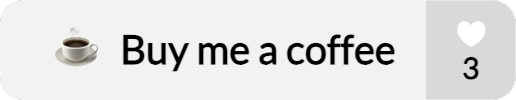
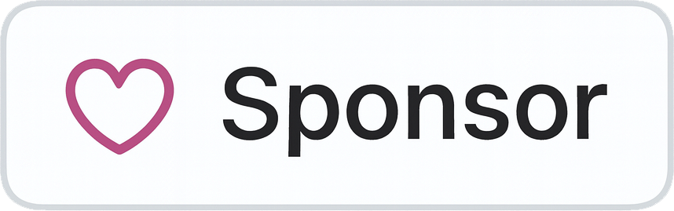
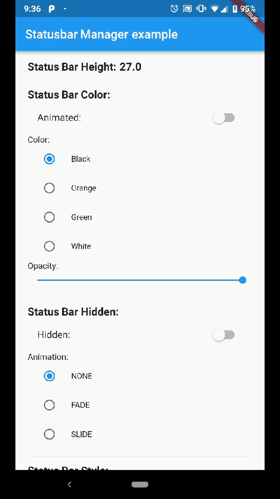
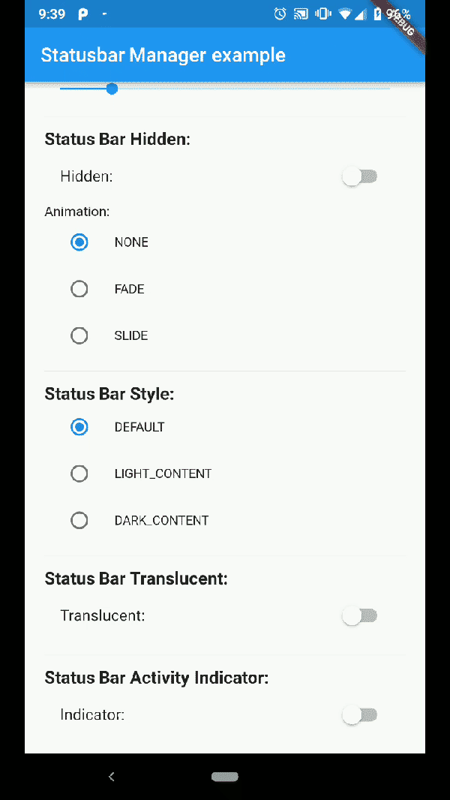
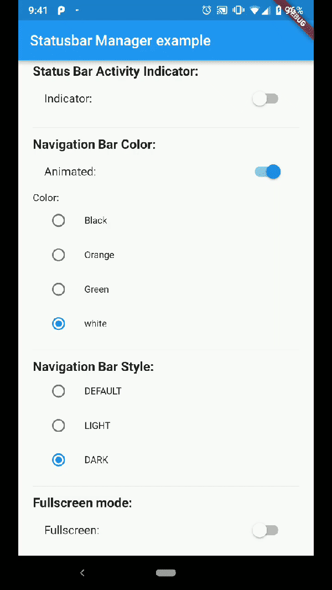
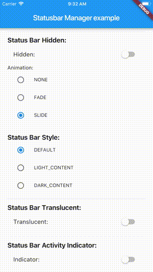
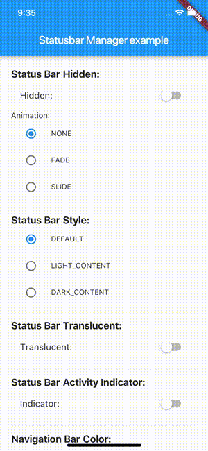

# Status Bar Control

[](https://github.com/rafaelmaeuer/flutter_statusbar_control/actions/workflows/tests.yml)

Since [flutter_statusbar_manager](https://pub.dev/packages/flutter_statusbar_manager) is no longer maintained, this package is a re-publish and will be occasionally updated for continued use in existing projects.

<p align="left">
<a href="https://www.buymeacoffee.com/rafaelmaeuer" target="_blank"></a>
&nbsp;&nbsp;
<a href="https://www.paypal.com/donate/?hosted_button_id=MAF7H5NNRMFAC" target="_blank"></a>
&nbsp;&nbsp;
<a href="https://github.com/sponsors/rafaelmaeuer" target="_blank"></a>
</p>

### About

`Status Bar Control`, lets you control the status bar color, style (theme), visibility, and translucent properties across iOS and Android. With some added bonus for Android to control the Navigation Bar.

This plugin is based on React Native's [StatusBar](https://facebook.github.io/react-native/docs/statusbar) component.

The Navigation Bar code was taken from the awesome [flutter-screen-theme-plugin](https://github.com/g123k/flutter-screen-theme-plugin).

The plugin was tested with Flutter 3.47, iOS 26 and Android 14 / 16 (API 34 / 36). It requires Flutter 3.27 or newer, iOS 13 and Android 5.0 (API 21).

### Last Updates

- v4.0.0 support Gradle 8/9, AGP 8/9, Swift Package Manager and Android 15+ edge-to-edge, thanks to [mbfakourii](https://github.com/mbfakourii) and [lukas-pierce](https://github.com/lukas-pierce)
- v3.2.0 rename to `status_bar_control` and re-publish to pub.dev
- v3.1.2 add `cutout`-mode for Android and `SafeArea` to demo app
- v3.1.1 resolve `UIOverlay`-deprecations and update of demo app
- v3.1.0 support for Android V2 thanks to [jWinterDay](https://github.com/jWinterDay) and [rafaelmaeuer](https://github.com/rafaelmaeuer)
- v3.0.1 compatible with flutter web thanks to [rafaelmaeuer](https://github.com/rafaelmaeuer)
- v3.0.0 support for null safety thanks to [NarHakobyan](https://github.com/NarHakobyan)
- v2.0.0 compatible with AndroidX thanks to [lorenzOliveto](https://github.com/lorenzOliveto)

See [CHANGELOG](CHANGELOG.md) for a complete list of changes.

### Examples

Build the example project for iOS and Android from the [example](./example) folder.

#### Android

|                                                                  Status Bar Color                                                                  |                                                                       Status Bar Hide                                                                        |                                                                Navigation Bar                                                                |
| :------------------------------------------------------------------------------------------------------------------------------------------------: | :----------------------------------------------------------------------------------------------------------------------------------------------------------: | :------------------------------------------------------------------------------------------------------------------------------------------: |
|  |  |  |

#### iOS

|                                                          Demo Iphone 8                                                          |                                                          Demo Iphone X                                                          |
| :-----------------------------------------------------------------------------------------------------------------------------: | :-----------------------------------------------------------------------------------------------------------------------------: |
|  |  |

*Note: not all of the shown examples might still work in the latest versions of Android or iOS*

## Installation

```bash
status_bar_control: ^4.0.0
```

to your `pubspec.yaml` and run

```bash
flutter pub get
```

in your project's root directory.

### Basic Usage

Create a new project with command

```sh
flutter create myapp
```

On iOS add the following in your `Info.plist` (if not already present):

```xml
<key>UIViewControllerBasedStatusBarAppearance</key>
<false/>
```

On Android add the following in your `styles.xml` (cutout-mode for API >27):

```xml
<item name="android:windowLayoutInDisplayCutoutMode" tools:targetApi="o_mr1">shortEdges</item>
```

Import the plugin in `lib/main.dart` like this:

```dart
import 'package:status_bar_control/status_bar_control.dart';
```

## Methods

#### setColor
###### Platforms: Android

The `setColor` method will set the status bar background color. On iOS the method will always return a successful `Future`.

*Note: apps targeting Android 15 (API 35) or higher are always drawn edge-to-edge and the system ignores status bar colors. In this case the plugin draws a colored view behind the status bar instead, which covers the app content in that area.*

| Parameter |  Type   | Default | Required | Description                                                     |
| :-------- | :-----: | :-----: | :------: | :-------------------------------------------------------------- |
| color     | `Color` |  none   |   Yes    | The color to be set as background, can use colors with opacity. |
| animated  | `bool`  |  false  |    No    | Whether or not to animate the color change.                     |

```dart
await StatusBarControl.setColor(Colors.green, animated:true);
```

#### setTranslucent
###### Platforms: Android

The `setTranslucent` method will set the status bar translucent status. On iOS the methods will always return a successful `Future`.

| Parameter   |  Type  | Default | Required | Description                                        |
| :---------- | :----: | :-----: | :------: | :------------------------------------------------- |
| translucent | `bool` |  none   |   Yes    | Whether or not the status bar will be translucent. |

```dart
await StatusBarControl.setTranslucent(true);
```

#### setHidden
###### Platforms: Android, iOS

The `setHidden` will hide the status bar.

| Parameter |         Type         |         Default         | Required | Description                               |
| :-------- | :------------------: | :---------------------: | :------: | :---------------------------------------- |
| hidden    |        `bool`        |          none           |   Yes    | Whether or not to hide the status bar.    |
| animation | `StatusBarAnimation` | StatusBarAnimation.NONE |    No    | The hiding animation to use `(iOS only)`. |

```dart
await StatusBarControl.setHidden(true, animation:StatusBarAnimation.SLIDE);
```

#### setStyle
###### Platforms: Android, iOS

The `setStyle` method will set the status bar theme.

| Parameter |       Type       | Default | Required | Description                                                                  |
| :-------- | :--------------: | :-----: | :------: | :--------------------------------------------------------------------------- |
| style     | `StatusBarStyle` |  none   |   Yes    | The status bar theme to use for styling, can either be light, dark, default. |

```dart
await StatusBarControl.setStyle(StatusBarStyle.DARK_CONTENT);
```

#### setNetworkActivityIndicatorVisible
###### Platforms: iOS

The `setNetworkActivityIndicatorVisible` method will show or hide the activity indicator, On Android the method will always return a successful `Future`.

| Parameter |  Type  | Default | Required | Description                                    |
| :-------- | :----: | :-----: | :------: | :--------------------------------------------- |
| visible   | `bool` |  none   |   Yes    | Whether or not to show the activity indicator. |

```dart
await StatusBarControl.setNetworkActivityIndicatorVisible(true);
```

#### getHeight
###### Platforms: Android, iOS

The `getHeight` getter method will return the height of the status bar.

```dart
double height = await StatusBarControl.getHeight
```

## Bonus Methods

#### setNavigationBarColor
###### Platforms: Android

The `setNavigationBarColor` method will set the navigation bar background color. On iOS the method will always return a successful `Future`.

*Note: on Android 15 (API 35) or higher the same applies as for `setColor`, the color is drawn by a view behind the navigation bar.*

| Parameter |  Type   | Default | Required | Description                                 |
| :-------- | :-----: | :-----: | :------: | :------------------------------------------ |
| color     | `Color` |  none   |   Yes    | The color to be set as background.          |
| animated  | `bool`  |  false  |    No    | Whether or not to animate the color change. |

```dart
await StatusBarControl.setNavigationBarColor(Colors.green, animated:true);
```

#### setNavigationBarStyle
###### Platforms: Android

The `setNavigationBarStyle` method will set the navigation bar theme.

| Parameter |         Type         | Default | Required | Description                                                                      |
| :-------- | :------------------: | :-----: | :------: | :------------------------------------------------------------------------------- |
| style     | `NavigationBarStyle` |  none   |   Yes    | The navigation bar theme to use for styling, can either be light, dark, default. |

```dart
await StatusBarControl.setNavigationBarStyle(NavigationBarStyle.DARK);
```

#### setFullscreen
###### Platforms: Android, iOS

The `setFullscreen` method will set the app in fullscreen mode.

| Parameter  |  Type  | Default | Required | Description                                       |
| :--------- | :----: | :-----: | :------: | :------------------------------------------------ |
| fullscreen | `bool` |  none   |   Yes    | Whether or not to set the app on fullscreen mode. |

```dart
await StatusBarControl.setNavigationBarStyle(NavigationBarStyle.DARK);
```

## Enums

#### StatusBarStyle

- StatusBarStyle.DEFAULT
- StatusBarStyle.LIGHT_CONTENT
- StatusBarStyle.DARK_CONTENT

#### StatusBarAnimation

- StatusBarAnimation.NONE
- StatusBarAnimation.FADE
- StatusBarAnimation.SLIDE

#### NavigationBarStyle

- NavigationBarStyle.DEFAULT
- NavigationBarStyle.DARK
- NavigationBarStyle.LIGHT

## Status bar
**Compatibility**: Android (6.0+) & iOS

On Android, it will only work with Android 6.0 (Marshmallow) and above devices.

## Navigation bar
**Compatibility**: Android only

Android 5.0 (Lollipop) and above: color

Android 8.0 (Oreo) and above: style (dark/light)
